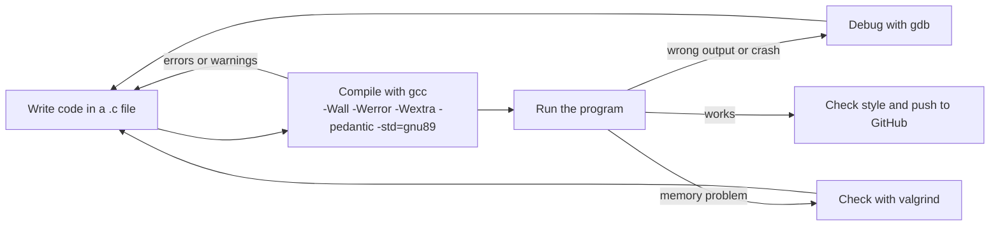

# Holberton School - Low Level Programming

My work for the C programming and low-level programming curriculum at Holberton School.
Each folder is one project, and most exercises are small C programs.

## Projects

### Core C projects

| Folder | Topic |
| --- | --- |
| [hello_world](hello_world/) | First C programs and the compilation steps |
| [variables_if_else_while](variables_if_else_while/) | Variables, conditions and loops |
| [functions_nested_loops](functions_nested_loops/) | Functions and nested loops |
| [more_functions_nested_loops](more_functions_nested_loops/) | More practice with functions and nested loops |
| [pointers_arrays_strings](pointers_arrays_strings/) | Pointers, arrays and strings |
| [recursion](recursion/) | Recursive functions |
| [argc_argv](argc_argv/) | Command line arguments |
| [malloc_free](malloc_free/) | Dynamic memory with `malloc` and `free` |
| [more_malloc_free](more_malloc_free/) | More dynamic memory exercises |
| [structures_typedef](structures_typedef/) | `struct` and `typedef` |
| [function_pointers](function_pointers/) | Pointers to functions |
| [variadic_functions](variadic_functions/) | Functions with a variable number of arguments |
| [singly_linked_lists](singly_linked_lists/) | Singly linked lists |
| [doubly_linked_lists](doubly_linked_lists/) | Doubly linked lists |
| [hash_tables](hash_tables/) | Hash tables |
| [file_io](file_io/) | Reading and writing files |

### Debugging, analysis and extra projects

| Folder | What is inside |
| --- | --- |
| [intro_debugging](intro_debugging/) | Notes about GDB (`gdb_fundamentals.txt`, `gdb_vsc.txt`) and a sample program, `source.c` |
| [dynamic_analysis](dynamic_analysis/) | Small programs for dynamic analysis: `multiplication_table.c`, `row_sums.c`, `sum_to_n.c` |
| [benchmarking](benchmarking/) | Timing and comparing code: `baseline_loop.c`, `comparison_algorithms.c`, `instrumentation_lab.c`, and the written analysis `green_efficiency_analysis.md` |
| [secure_data_handling](secure_data_handling/) | A small session and store module (`session.c`, `store.c` and their headers) |
| [ai_memory_visualizer_valgrind_tracer](ai_memory_visualizer_valgrind_tracer/) | Reports in `analysis/`: `crash_report.md`, `memory_maps.md`, `valgrind_analysis.md` |
| [simple-calculator](simple-calculator/) | A simple calculator in C (`calculator.c`) |

### Separate repositories

- [holbertonschool-printf](https://github.com/arif-almusharafi/holbertonschool-printf) - my own `_printf`
- [holbertonschool-sorting_algorithms](https://github.com/arif-almusharafi/holbertonschool-sorting_algorithms) - sorting algorithms in C

## How I work on a project



## Compile and run

```bash
gcc -Wall -Werror -Wextra -pedantic -std=gnu89 file.c -o program
./program
```

Check memory problems:

```bash
valgrind --leak-check=full ./program
```

## Concepts practiced

- C syntax, functions and the compilation process
- Pointers, arrays and strings
- Dynamic memory management and memory leaks
- Data structures: linked lists and hash tables
- Function pointers and variadic functions
- File input and output
- Debugging with GDB and Valgrind

## Author

Arif Almusharafi - [GitHub](https://github.com/arif-almusharafi)
